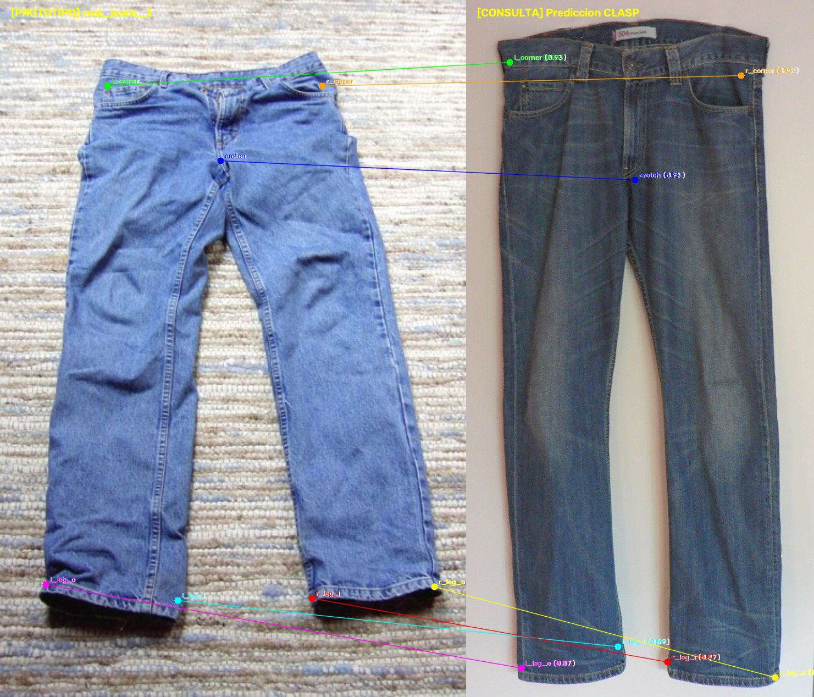
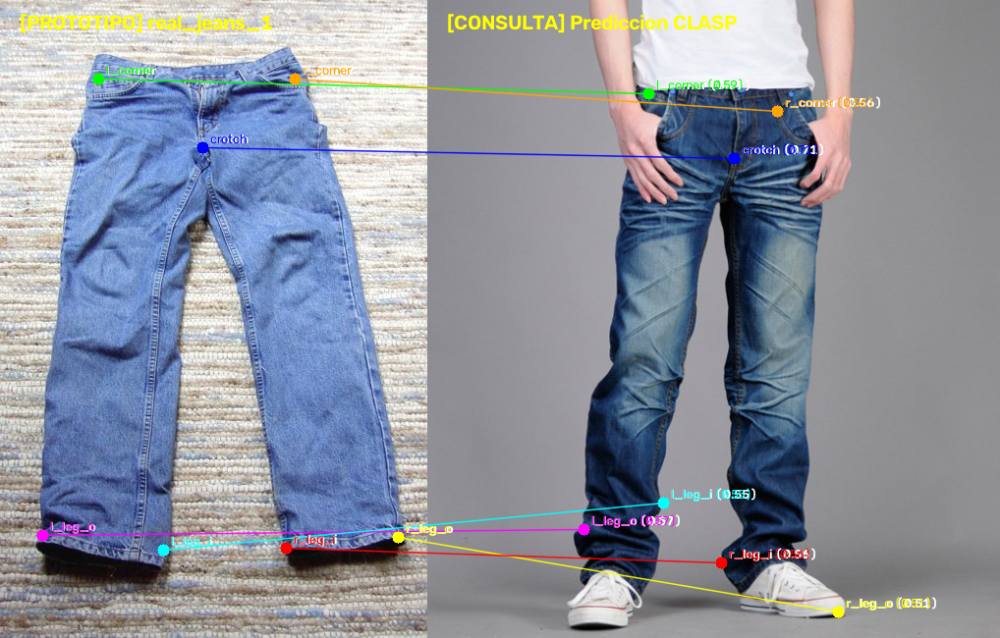
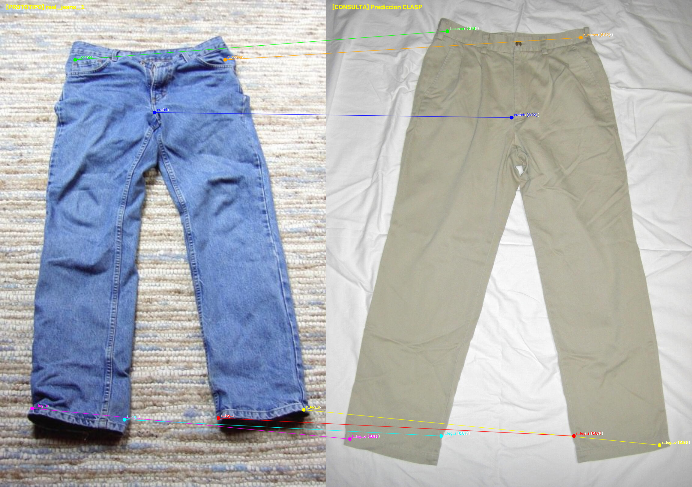
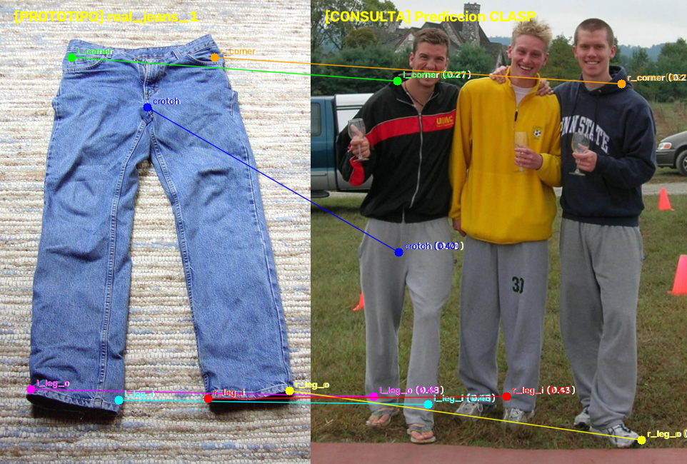

# CLASP: Cloth Assistance with Semantic Keypoints & Interactive Perception

> **Independent Academic Reproduction & Experimental Implementation**  
> *Reference Paper: CLASP: General-Purpose Clothes Manipulation with Semantic Keypoints (Deng et al., IJRR 2026 / ICRA 2025 / arXiv:2502.17983)*  
> *Core Focus: Zero-Shot Dense Semantic Matching (Frozen DINOv2 ViT), 3D Pinhole Deprojection, and Closed-Loop Interactive Perception (Tactile Touchdown & Proprioceptive Verification)*

---

> [!IMPORTANT]
> **Academic Reproduction & Non-Plagiarism Disclaimer**  
> This repository is an **independent academic reproduction and experimental implementation** created strictly for research, testing, and educational purposes in robotics and artificial intelligence. All foundational theoretical concepts, algorithmic architectures, and task formulations are fully attributed to the original authors (*Deng et al., 2025*). This work does not claim ownership of the original methodology and is published without commercial intent or purpose of plagiarism.

---

## Quick Navigation Index

| Section | Description | Direct Link |
| :--- | :--- | :--- |
| **System Overview** | Vision foundation model matching and closed-loop tactile grasp | [System Overview](#system-overview) |
| **Mathematical Formulation** | Dense cosine similarity, SE(3) transformation, FSM thresholds | [Mathematical Formulation](#mathematical-formulation) |
| **Interactive Perception** | Closed-loop touch: hover, touchdown (3N), proprioception | [Interactive Perception](#interactive-perception) |
| **Experimental Results** | Keypoint transfer across diverse garment instances (jeans, chinos) | [Experimental Results](#experimental-results) |
| **Repository Structure** | Codebase layout across pipeline, perception, data, and docs | [Repository Structure](#repository-structure) |
| **Execution Guide** | Step-by-step instructions to extract features and run matching | [Execution Guide](#execution-guide) |

---

## System Overview

Manipulating crumpled garments across unseen categories requires landmark semantic correspondence without expensive fine-tuning. This repository implements the **CLASP** framework, combining zero-shot dense visual descriptors with closed-loop physical interaction:

```
+-----------------------------------+       +-----------------------------------+
|  Canonical Prototype Annotation   |       |    Observed Test Garment RGB-D    |
|   (Annotated landmarks {q_k})     |       |   (Arbitrary pose, crumpled cloth)|
+-----------------+-----------------+       +-----------------+-----------------+
                  |                                           |
                  +---------------------+---------------------+
                                        |
                                        v
                    [ Frozen DINOv2 Feature Extractor ]
                           (Normalized f(p) in R^D)
                                        |
                                        v
                    [ Coarse-to-Fine Landmark Matching ]
                       p_k* = argmax cos(f_obs, f_proto)
                                        |
                                        v
                   [ 3D Pinhole & Frame Deprojection SE(3) ]
                     p_base = T_base^cam * (Z * K^-1 * [u, v, 1]^T)
                                        |
                                        v
                    [ Closed-Loop Interactive Perception FSM ]
                     ├── 1. Hover (+6 cm normal to cloth)
                     ├── 2. Touchdown (F_z >= 3.0 N)
                     ├── 3. Proprioceptive Grip Verification (delta_grip)
                     └── 4. Lift-and-Verify (+15 cm tension check)
```

### Visual Highlights

| Semantic Matching on Real Jeans 2 | Semantic Matching on Real Jeans 3 |
| :---: | :---: |
|  |  |

| Cross-Garment Transfer (Chino) | Cross-Garment Transfer (Sweatpants) |
| :---: | :---: |
|  |  |

---

## Mathematical Formulation

### 1. Dense Semantic Descriptor Matching (Frozen DINOv2)
Rather than training brittle task-specific keypoint detectors, semantic representations are extracted from an un-finetuned foundation model (DINOv2 ViT-B/14):
$$\mathbf{f}(p) = \frac{\phi_{\text{ViT}}(I, p)}{\|\phi_{\text{ViT}}(I, p)\|_2} \in \mathbb{R}^D$$
Given an annotated prototype $I_{\text{proto}}$ with keypoint coordinates $\{q_k\}_{k=1}^K$, the corresponding location $p_k^*$ in the observed scene $I_{\text{obs}}$ is found by maximizing cosine similarity:
$$p_k^* = \arg\max_{p \in \Omega} \frac{\mathbf{f}_{\text{obs}}(p)^\top \mathbf{f}_{\text{proto}}(q_k)}{\|\mathbf{f}_{\text{obs}}(p)\|_2 \|\mathbf{f}_{\text{proto}}(q_k)\|_2}$$

### 2. Pinhole Deprojection & Base Frame Transformation
Given the metric depth $Z = d(u, v)$ and camera intrinsic matrix $K$, the 2D keypoint is lifted to 3D camera coordinates and transformed to the manipulator base frame $\mathcal{F}_{\text{base}}$ via hand-eye extrinsic $T_{\text{base}}^{\text{cam}} \in SE(3)$:
$$\mathbf{p}_{\text{cam}} = Z \cdot K^{-1} \begin{bmatrix} u \\ v \\ 1 \end{bmatrix}, \quad \mathbf{p}_{\text{base}} = T_{\text{base}}^{\text{cam}} \begin{bmatrix} \mathbf{p}_{\text{cam}} \\ 1 \end{bmatrix}_{1:3}$$

---

## Interactive Perception

Open-loop visual grasping often fails due to cloth slippage, table collisions, or grasping multiple layers unintentionally. The closed-loop FSM (`clasp_interactive_perception.py`) guarantees robust physical execution:

1. **Approach & Hover:** Moves the end-effector to a standoff position $+6.0\,\text{cm}$ above $\mathbf{p}_{\text{base}}$ along the surface normal vector.
2. **Tactile Touchdown:** Drives the gripper downward at constant velocity ($1.5\,\text{cm/s}$) until an axial normal force threshold is triggered:
   $$F_z \ge 3.0\,\text{N}$$
   preventing excessive reaction torques on robot joints and adapting to uneven surfaces.
3. **Proprioceptive Grasp Discrimination:** Closes gripper fingers and measures the residual gap $\delta_{\text{grip}}$:
   $$\delta_{\text{min}} \le \delta_{\text{grip}} \le \delta_{\text{max}}$$
   * If $\delta_{\text{grip}} < \delta_{\text{min}}$: Gripper missed the fabric (empty closure).
   * If $\delta_{\text{grip}} > \delta_{\text{max}}$: Multiple accidental layers or thick hem captured.
4. **Lift-and-Verify:** Ascends $+15\,\text{cm}$ vertically to confirm stable tension.

---

## Repository Structure

```text
clasp_semantic_keypoints/
├── .gitignore
├── README.md                                 <- Master documentation
├── docs/
│   ├── CLASP_SemanticKeypoints_2025.pdf      <- Reference paper (Deng et al.)
│   ├── 01_CLASP_Framework_and_First_Principles.md <- Epistemic study guide
│   ├── 02_CLASP_Foundation_Models_Ecosystem.md   <- Foundation models architecture
│   └── images/                               <- Semantic matching visualizations
├── src/
│   ├── 02_dino_extractor.py                  <- DINOv2 dense GPU feature extractor
│   ├── 03_matcher.py                         <- Coarse-to-fine keypoint matcher
│   ├── 04_rotation_aligner.py                <- 2D in-plane orientation normalizer
│   ├── 05_deprojector_3d.py                  <- Pinhole inverse 3D transformer
│   ├── clasp_interactive_perception.py       <- Complete closed-loop FSM (touchdown & verify)
│   ├── action_primitives.py                  <- Motion planning primitives
│   ├── inference.py                          <- End-to-end evaluation runner
│   ├── simulation_utils.py                   <- Simulation interface helpers
│   └── metric.py                             <- Landmark error evaluation
└── data/
    ├── prototypes/                           <- Reference annotated prototypes
    └── samples/                              <- Real garment evaluation images
```

---

## Execution Guide

### 1. Requirements & Dependencies
```bash
pip install torch torchvision numpy opencv-python scipy matplotlib
```

### 2. Extract Features & Run Semantic Matching
```bash
python src/02_dino_extractor.py
python src/03_matcher.py
```

### 3. Run Closed-Loop Interactive Perception (Simulation / Robot)
```bash
python src/clasp_interactive_perception.py
```

---

## References & Attribution

* Deng, et al. (2025). *CLASP: General-Purpose Clothes Manipulation with Semantic Keypoints*. arXiv:2502.17983.
* Oquab, M., et al. (2023). *DINOv2: Learning Robust Visual Features without Supervision*. Transactions on Machine Learning Research.
